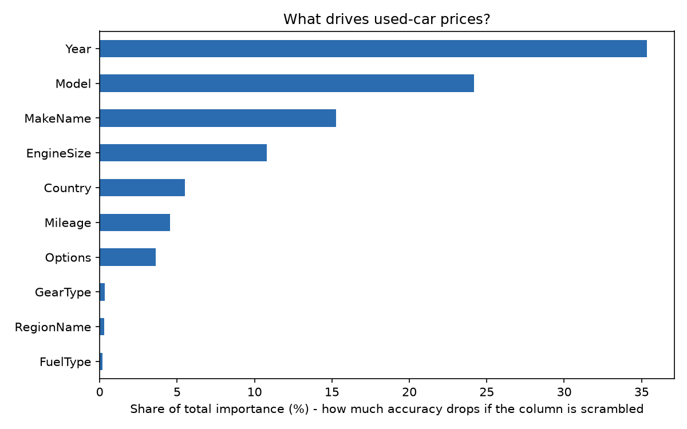
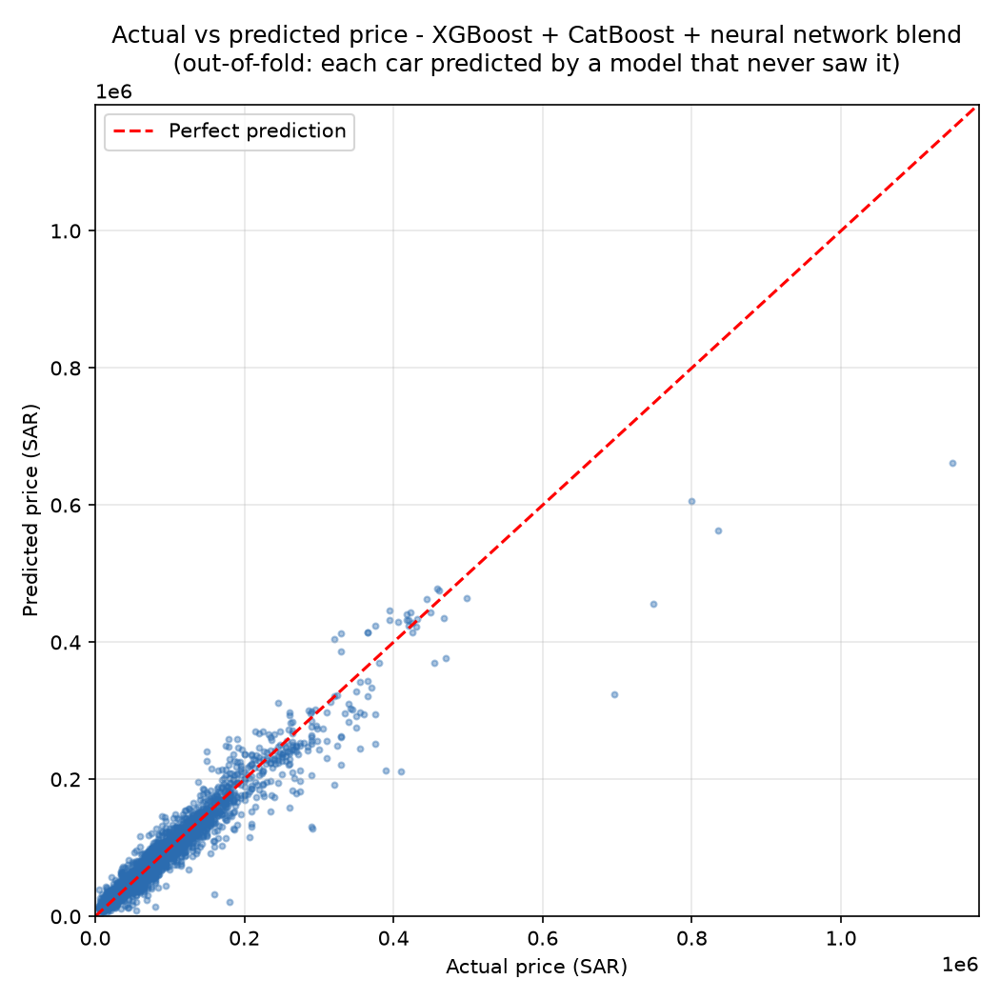

# Saudi Used-Car Price Predictor

## What does this model do?

It looks at a used car's **make, model, year, mileage, engine size, options level, gearbox, fuel type and region** and estimates a fair asking price in Saudi riyals (SAR). It learned from 4,286 real listings exported from OurCars, an MS Access database built by a group of MIS 201 (Introduction to Information Systems) students. This repo holds only the machine-learning part, which I built to help them; the model's predicted price is imported back into their database, where a query flags overpriced cars.

The model is a **blend of three models**, and the final price is their average:
- **XGBoost** and **CatBoost** are "gradient boosting" models. Think of each as hundreds of small decision trees, each one correcting the mistakes of the ones before it.
- A small **neural network** has one layer of 64 "neurons" that learn weighted combinations of the inputs.

Each model makes different mistakes, so averaging them cancels some of the errors out.

## How accurate is it?

We tested with **5-fold cross-validation**: the cars are split into 5 groups, and each group is predicted by a model trained only on the other four. So **every prediction in `predictions.csv` is for a car the model never saw**. This is the honest way to measure accuracy, because a model that predicts cars it has already memorised looks much better than it really is.

| Step | Average error (MAE) | R² | Within 10,000 SAR |
|---|---|---|---|
| Random Forest (first try) | 11,142 SAR | 0.893 | |
| XGBoost (baseline) | 9,989 SAR | 0.926 | 69% |
| + fixed mileage typos | 9,949 SAR | 0.922 | |
| + tuned XGBoost | 9,814 SAR | 0.918 | |
| + blend with CatBoost | 9,574 SAR | 0.908 | 71% |
| Neural network alone | 10,329 SAR | 0.910 | 69% |
| **+ neural network in the blend (final)** | **9,347 SAR** | **0.919** | **72%** |

Tuning and blending cut the average error by about 6% overall. The mileage fix, extra features and grouping rare models gave almost nothing.

On its own, the neural network is worse than XGBoost, as expected for a small table of 4,286 cars. It still helps inside the blend because its mistakes are different. We re-checked this gain on a second, differently shuffled split, and it held there too (9,610 down to 9,382 SAR). The full table is in the notebook.

In plain words:
- **MAE** = on average, the estimate is off by about **9,300 SAR**. The average car costs about 77,000 SAR (the typical car, the median, is 58,000 SAR). The typical miss is smaller, about 5,300 SAR, because a few expensive cars have big errors.
- **R² = 0.92** means the model explains about 92% of why prices differ between cars. 100% would be perfect; 0% would be no better than guessing the average.
- About **72% of cars** are predicted within 10,000 SAR and **90%** within 20,000 SAR.

## The 3 most important features

We measured importance by scrambling one column at a time and seeing how much worse the predictions get. The more accuracy drops, the more the model depends on that column.

1. **Year (about 35%)**: newer cars are worth much more, and age is the strongest single driver of price.
2. **Model (about 24%)**: the specific model, such as a Land Cruiser versus a Yaris, sets the price range.
3. **Make (about 15%)**: the brand, such as Mercedes versus Hyundai, adds to that.

Engine size comes next (about 11%), because bigger engines usually mean bigger, pricier vehicles. Country of origin, mileage and options level matter a little (4-6% each). Region, fuel type and gearbox barely change the price in this data.




The scatter plot shows the actual price against the predicted price. Points close to the red dashed line are good predictions. The model is least accurate for very expensive cars, because there are few of them to learn from.

## Files

| File | What it is |
|---|---|
| `car_price_model.ipynb` | The whole pipeline: clean, compare, improve, predict, charts, live demo |
| `carmodel.py` | Helper code shared by the notebook and `predict.py` (data loading, the three models and the blend) |
| `predict.py` | Live demo: type in a car, get a price |
| `predictions.csv` | `CarID, PredictedPrice` for all 4,286 cars (out-of-fold, in whole SAR) |
| `feature_importance.png`, `actual_vs_predicted.png` | The two charts shown below |
| `model.joblib` | The final model, trained on all the data |
| `metrics.json` | All the cross-validation numbers |
| `cars_export.csv` | The 4,286 cleaned listings, exported from the Access database (source: the Saudi Arabia Used Cars Dataset on Kaggle, collected from Syarah) |

## How to run (Windows, PowerShell)

```powershell
python -m venv .venv
.\.venv\Scripts\Activate.ps1
pip install -r requirements.txt
jupyter notebook car_price_model.ipynb   # Run All (a few minutes); recreates all outputs
python predict.py                        # terminal demo (or run the last notebook cell)
```

In the demo, type the make and model (capital letters don't matter). For region, engine size, gearbox, fuel and options you can just press **Enter** to accept the default.

## Things to know

- Cleaning: the Access export writes prices as `$95000.00`; the `$` is removed (the numbers are SAR). `Age` is dropped because it is always `2026 - Year`. About 8% of cars had mileage under 1,000 (for example 230), clearly typed in thousands of km, so those are multiplied by 1,000. No rows were removed, so every car gets a prediction.
- A few model names in the data are odd (such as "Furniture" and "Ciocca"). They are left in as they are.
- The model can only reason about makes and models that appear in the data, so `predict.py` offers only those.
- It is an estimate to guide a conversation, not a guaranteed price. Condition, accident history and negotiation are not in the data.
